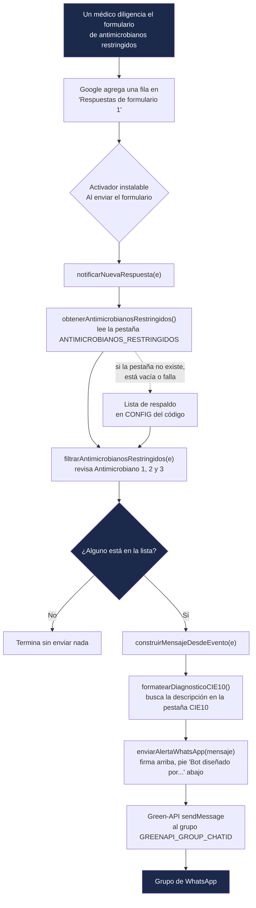

# Alertas WhatsApp - PROA Antimicrobianos Restringidos HDV

Bot de Google Apps Script que avisa por **WhatsApp** (vía [Green-API](https://green-api.com/en/)) cada vez que en el **FORMULARIO DE ANTIMICROBIANOS RESTRINGIDOS HDV** se prescribe uno de los antimicrobianos restringidos del Programa de Optimización de Antimicrobianos (PROA) del Hospital Departamental de Villavicencio E.S.E. (HDV). Si la solicitud no incluye ningún restringido, no envía nada. No envía correo.

| Recurso | Enlace |
|---|---|
| Formulario | [FORMULARIO DE ANTIMICROBIANOS RESTRINGIDOS HDV](https://docs.google.com/forms/d/1u8XYmynHfAH0EoeyNFFcd8w12IA95J47oItrv34TyGI/edit) |
| Hoja de respuestas | [MATRIZ FORMULARIO DE ANTIMICROBIANOS RESTRINGIDOS HDV (Respuestas)](https://docs.google.com/spreadsheets/d/1ZsjuygpRz1wPhCRxmL8LPLTNOo8kujGXplX8JRs6SZY/edit) |
| Proyecto Apps Script | [PROA ALERTAS](https://script.google.com/u/1/home/projects/12mUy9SqQGzRnGjkbAsFyycG9RxJxvFePpSuHl4Nv8MokONxKY7kwbIw0/edit) (independiente, no vinculado a la hoja; archivo "Código") |
| Código en este repo | `Codigo.gs` |

La misma hoja tiene vinculado otro script, **FORMULARIO PROA DOT**, que calcula los días de terapia. Son proyectos separados y este bot no lo toca.

## Cómo funciona



Paso a paso:

1. **Llega una solicitud.** Al enviarse el formulario, Google agrega una fila a la hoja y dispara el activador "Al enviar el formulario", que llama a `notificarNuevaRespuesta(e)`.
2. **Se carga la lista de restringidos** desde la pestaña `ANTIMICROBIANOS_RESTRINGIDOS` de la misma hoja (columna A, desde la fila 2). Si esa pestaña no existe, está vacía o falla la lectura, se usa `CONFIG.ANTIMICROBIANOS_RESTRINGIDOS_RESPALDO`, para que las alertas nunca dejen de funcionar por eso.
3. **Se revisan los 3 antimicrobianos de la solicitud.** El formulario guarda el nombre con un código interno (`LINEZOLID - UT-19907394-3`). `nombreLimpio()` quita todo desde ` - UT-`, se pasa a mayúsculas y se marca como restringido si el nombre **contiene** alguno de la lista. Por eso `CASPOFUNGINA` cubre `CASPOFUNGINA 50, 70`, y `ANFOTERICINA` cubre la convencional y la liposomal.
4. **Si ninguno es restringido, termina** sin enviar nada. Es lo más común: la mayoría de solicitudes son de cefepime, piperacilina/tazobactam, meropenem, etc.
5. **Si hay al menos uno, arma el mensaje.** El diagnóstico se busca en la pestaña `CIE10` por su código (por ejemplo, `A419` pasa a `A419 - Sepsis, no especificada`); si no lo encuentra, deja lo que escribió el médico. Se agrega un bloque por cada antimicrobiano restringido con dosis, vía, frecuencia y días.
6. **WhatsApp.** `enviarAlertaWhatsApp()` pone la firma en negrita arriba (`Bot PROA Antimicrobianos HDV` o lo que diga `GREENAPI_BOT_LABEL`) y el pie en cursiva abajo, y hace un `POST` a `sendMessage` de Green-API. Si Green-API responde con error o no hay conexión, lo deja en el registro sin detener la ejecución.

### Antimicrobianos restringidos

La lista vigente está en la pestaña **`ANTIMICROBIANOS_RESTRINGIDOS`** de la matriz:

Linezolid · Ceftazidima / Avibactam · Anfotericina · Aztreonam · Ertapenem · Vancomicina · Caspofungina · Anfotericina B liposomal · Tygeciclina · Doripenem · Rifampicina · Polimixina B · Daptomicina

**Para agregar o quitar un antimicrobiano no hay que tocar el código:** basta con editar esa pestaña, una fila por antimicrobiano. Hay que escribirlo como aparece en el formulario (por ejemplo `TYGECICLINA` con Y). Ojo con nombres muy cortos o genéricos: como la comparación es por "contiene", un término como `CEF` alertaría por todas las cefalosporinas.

Si se cambia la lista de la pestaña, conviene actualizar también la de respaldo en `CONFIG` (y en `test/dry-run.js`), para que coincidan si alguna vez falla la lectura.

### Datos del mensaje

| En el mensaje | Pregunta del formulario (título exacto) |
|---|---|
| 📄 Historia Clínica | `Número de Historia Clínica` |
| 🎂 Edad | `Edad del paciente en años`; si está vacía, `Edad del paciente meses` |
| 📋 Diagnóstico CIE10 | `Diagnóstico CIE10 para la cual se prescribe el antimicrobiano` (+ descripción de la pestaña `CIE10`) |
| 🦠 Microorganismo aislado | `Microorganismo aislado` |
| 🩺 Especialidad que prescribe | `Especialidad que prescribe` |
| 🏥 Servicio actual | `Servicio actual` |
| 🧪 Interconsulta Infectología | `¿Solicitó interconsulta por infectología en Dinámica Gerencial?` |
| 💊 Antimicrobiano restringido | `Nombre Antimicrobiano 1/2/3` con su dosis, vía, frecuencia y días |

Los títulos de las columnas del formulario son inconsistentes y hay que copiarlos tal cual. Por ejemplo, la dosis del primero dice `AB1` y las otras `AM2`/`AM3`; la frecuencia del primero dice `(En Horas)` y las otras `(En horas)`; la vía dice `adminsitración`, con la errata, y lleva dos espacios antes de `AM1`. `campo()` busca el título **exacto**: si alguien edita una pregunta, ese dato sale como `-` (o el antimicrobiano no se detecta) sin ningún error.

### Ejemplo (datos ficticios)

```
*Bot PROA Antimicrobianos HDV*

🚨 NUEVO CASO PROA - ANTIMICROBIANO RESTRINGIDO 🚨

📄 Historia Clínica: 99999999
🎂 Edad: 54 años
📋 Diagnóstico CIE10: A419 - Sepsis, no especificada
🦠 Microorganismo aislado: Staphylococcus aureus resistente a meticilina
🩺 Especialidad que prescribe: Medicina Interna
🏥 Servicio actual: Unidad de Cuidado Crítico UCI C
🧪 Interconsulta Infectología (Dinámica Gerencial): Sí

💊 Antimicrobiano restringido 1: LINEZOLID
   Dosis: 600 mg/UI
   Vía de administración: Intravenoso
   Frecuencia: cada 12 horas
   Días ordenados: 14

_Bot diseñado por el QF Juan Pablo Saavedra · Servicio Farmacéutico HDV_
```

## Configuración

### En el código (`CONFIG`)

| Clave | Valor |
|---|---|
| `SPREADSHEET_ID` | ID de la matriz de respuestas |
| `HOJA_ANTIMICROBIANOS_RESTRINGIDOS` | `ANTIMICROBIANOS_RESTRINGIDOS` |
| `ANTIMICROBIANOS_RESTRINGIDOS_RESPALDO` | Lista de respaldo |
| `HOJA_CIE10` | `CIE10` (columna A código, columna B descripción) |

### Propiedades del script

En el editor de Apps Script: **Configuración del proyecto → Propiedades del script**. Ninguna credencial va en el código: este repositorio es público.

| Propiedad | Obligatoria | Descripción |
|---|---|---|
| `GREENAPI_ID_INSTANCE` | sí | ID de la instancia de Green-API (compartida con los otros bots) |
| `GREENAPI_API_TOKEN` | sí | Token de la instancia (secreto) |
| `GREENAPI_API_URL` | sí | URL base de la API, ej. `https://7107.api.greenapi.com` |
| `GREENAPI_GROUP_CHATID` | sí | chatId del grupo de destino; siempre termina en `@g.us` |
| `GREENAPI_BOT_LABEL` | no | Firma en negrita al inicio del mensaje (por defecto `Bot PROA Antimicrobianos HDV`) |

Para encontrar el chatId de un grupo sin riesgo de enviar nada, ejecutar `listarChatsGreenAPI()`: solo lee (`getChats`) y registra los grupos (`@g.us`).

## Activador

El proyecto es independiente (no está vinculado a la hoja), así que el activador "Al enviar el formulario" **no** se puede crear desde la pantalla de Activadores. Se creó una sola vez ejecutando `crearTriggerFormSubmit()`. No volver a ejecutarla: crearía un segundo activador y cada alerta llegaría duplicada.

## Funciones

| Función | ¿Envía algo? | Uso |
|---|---|---|
| `notificarNuevaRespuesta(e)` | Sí, si hay restringido | La llama el activador |
| `obtenerAntimicrobianosRestringidos()` | **No** | Lee la pestaña de restringidos (o el respaldo) |
| `filtrarAntimicrobianosRestringidos(e)` | **No** | Devuelve los antimicrobianos restringidos de la solicitud |
| `construirMensajeDesdeEvento(e)` | **No** | Arma el texto del mensaje |
| `formatearDiagnosticoCIE10()`, `obtenerMapaCIE10()`, `extraerCodigoCIE10()` | **No** | Cruce del diagnóstico con la pestaña `CIE10` |
| `enviarAlertaWhatsApp(mensaje)` | Sí | Envío a Green-API con firma y pie |
| `listarChatsGreenAPI()` | **No** | Lista los grupos visibles para la instancia |
| `crearTriggerFormSubmit()` | No (crea el activador) | Ya se ejecutó; no repetir |
| `eventoPruebaLinezolid()`, `eventoPruebaVancomicina()`, `eventoPruebaSinRestringidos()` | **No** | Datos ficticios de prueba |
| `testConstruccionMensaje()` | **No** | Escribe en el registro los 3 casos de prueba (el de ceftriaxona no debe alertar) |
| `testCruceCIE10()` | **No** | Verifica en el registro el cruce con la pestaña `CIE10` |
| `enviarEjemploAlGrupo()` | Sí | Envía el caso ficticio de linezolid al grupo configurado |

Antes de ejecutar `enviarEjemploAlGrupo()`, confirmar que `GREENAPI_GROUP_CHATID` apunta a PRUEBA BOT (`120363412506101174@g.us`).

## Cómo se actualiza el bot

El editor de Apps Script **no** se sincroniza con GitHub. Para cambiar el bot:

1. Si solo cambia la lista de antimicrobianos, editar la pestaña `ANTIMICROBIANOS_RESTRINGIDOS`; no hace falta tocar el código.
2. Para cambios de código, editar `Codigo.gs` en este repo y correr las pruebas locales.
3. Copiar el cambio al editor (archivo "Código" del proyecto PROA ALERTAS) y guardar con Ctrl+S. No hace falta publicar: el activador usa siempre la última versión guardada.
4. Probar con `GREENAPI_GROUP_CHATID` en PRUEBA BOT antes de volver a producción.

Al pegar texto con tildes o emojis, el editor a veces los daña. Los textos nuevos se escriben con escapes `\u` (como el pie) o con `String.fromCodePoint()`.

## Pruebas locales (sin red ni credenciales)

```bash
node test/pie-firma.js   # carga el Codigo.gs real: pie de firma y filtro de los antimicrobianos nuevos
node test/dry-run.js     # reconstruye el filtro y el mensaje en Node
```

## Green-API compartida: cuidado con el cupo de chats

La instancia de Green-API es la misma para los 4 bots del Servicio Farmacéutico y está en el plan Developer (gratis). Ese plan **no limita mensajes, sino chats distintos por mes: 3**, contando los que escriben al número del bot; el contador se reinicia el día 1. Hoy se usan 2 (grupo de producción y PRUEBA BOT). Si se escribe a un cuarto chat, o alguien le escribe por privado al número del bot, Green-API responde 466 y **los 4 bots** dejan de enviar hasta el día 1.

| Bot | Qué lo dispara | Repositorio |
|---|---|---|
| Farmacovigilancia | Formulario FOREAM | [alertas-whatsapp-farmacovigilancia](https://github.com/jsaavedran1-glitch/alertas-whatsapp-farmacovigilancia) |
| Tecnovigilancia | Formulario FOREIA001 | [alertas-whatsapp-tecnovigilancia](https://github.com/jsaavedran1-glitch/alertas-whatsapp-tecnovigilancia) |
| PROA antimicrobianos | Formulario de antimicrobianos restringidos | este repositorio |
| Alertas INVIMA | Reloj (4 revisiones diarias) | [alertas-whatsapp-sanitarias-invima](https://github.com/jsaavedran1-glitch/alertas-whatsapp-sanitarias-invima) |

## Reglas

- **Solo a grupos.** El destino siempre termina en `@g.us`; nunca se envía a una persona (`@c.us`).
- **Ninguna credencial en el código.** Todo vive en Propiedades del script.
- **No modificar el script FORMULARIO PROA DOT** ni sus activadores.
- **Pruebas solo en PRUEBA BOT**, nunca en el grupo de producción.

## Marco regulatorio de referencia

Programa de Optimización de Antimicrobianos (PROA), Resolución 4816 de 2008, Resolución 3100 de 2019.

## Ver también

`CLAUDE.md` (contexto operativo para asistentes de IA) y `CHANGELOG.md` (historial de cambios).
