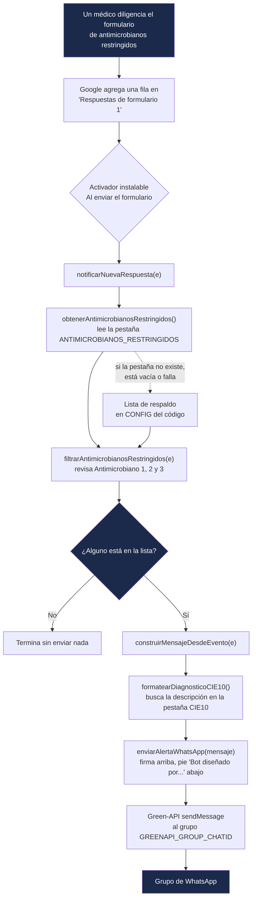

# Alertas WhatsApp - PROA Antimicrobianos Restringidos HDV

Bot de Google Apps Script que avisa por **WhatsApp** (vía [Green-API](https://green-api.com/en/)) cada vez que en el **FORMULARIO DE ANTIMICROBIANOS RESTRINGIDOS HDV** se prescribe uno de los antimicrobianos restringidos del Programa de Optimización de Antimicrobianos (PROA) del Hospital Departamental de Villavicencio E.S.E. (HDV). Si la solicitud no incluye ningún restringido, no envía nada. No envía correo.

| Recurso | Enlace |
|---|---|
| Formulario | [FORMULARIO DE ANTIMICROBIANOS RESTRINGIDOS HDV](https://docs.google.com/forms/d/1u8XYmynHfAH0EoeyNFFcd8w12IA95J47oItrv34TyGI/edit) |
| Hoja de respuestas | [MATRIZ FORMULARIO DE ANTIMICROBIANOS RESTRINGIDOS HDV (Respuestas)](https://docs.google.com/spreadsheets/d/1ZsjuygpRz1wPhCRxmL8LPLTNOo8kujGXplX8JRs6SZY/edit) |
| Proyecto Apps Script | [PROA ALERTAS](https://script.google.com/u/1/home/projects/12mUy9SqQGzRnGjkbAsFyycG9RxJxvFePpSuHl4Nv8MokONxKY7kwbIw0/edit) (independiente, no vinculado a la hoja; archivo "Código") |
| Código en este repo | `Codigo.gs` |

La misma hoja tiene vinculado otro script, **FORMULARIO PROA DOT**, que calcula los días de terapia. Son proyectos separados y este bot no lo toca.

## Cómo funciona



Paso a paso:

1. **Llega una solicitud.** Al enviarse el formulario, Google agrega una fila a la hoja y dispara el activador "Al enviar el formulario", que llama a `notificarNuevaRespuesta(e)`.
2. **Se carga la lista de restringidos** desde la pestaña `ANTIMICROBIANOS_RESTRINGIDOS` de la misma hoja (columna A, desde la fila 2). Si esa pestaña no existe, está vacía o falla la lectura, se usa `CONFIG.ANTIMICROBIANOS_RESTRINGIDOS_RESPALDO`, para que las alertas nunca dejen de funcionar por eso.
3. **Se revisan los 3 antimicrobianos de la solicitud.** El formulario guarda el nombre con un código interno (`ERTAPENEM - UT-19973898-1`). `nombreLimpio()` quita todo desde ` - UT-`, se pasa a mayúsculas y se marca como restringido si el nombre **contiene** alguno de la lista. Por eso `CASPOFUNGINA` cubre `CASPOFUNGINA 50, 70`, y `ANFOTERICINA` cubre la convencional y la liposomal.
4. **Si ninguno es restringido, termina** sin enviar nada. Es lo más común: la mayoría de solicitudes son de cefepime, piperacilina/tazobactam, meropenem, etc.
5. **Si hay al menos uno, arma el mensaje.** Además de historia clínica, edad y servicio, incluye lo que PROA interviene: peso y **mg/kg por dosis**, cama, indicación (empírico/etiológico/profiláctico), cultivos, origen (IAAS/comunidad), si fue un cambio de antimicrobiano y por qué, ajuste renal con depuración de creatinina, y un aviso cuando **no se pidió interconsulta a Infectología**. El diagnóstico se busca en la pestaña `CIE10` por su código (`G06.0` → `G060 - ABSCESO…`; `J40` → `J40X`); si no lo encuentra, deja lo que escribió el médico. Cada antimicrobiano restringido va con dosis, vía, frecuencia, días y **fecha fin prevista**; si la dosis queda fuera del rango de referencia de la pestaña `RANGOS_DOSIS`, se agrega `⚠️ … revisar`. Los antimicrobianos **no** restringidos de la misma solicitud salen como "Acompañante", para ver la combinación completa.
6. **WhatsApp.** `enviarAlertaWhatsApp()` pone la firma en negrita arriba (`Bot PROA Antimicrobianos HDV` o lo que diga `GREENAPI_BOT_LABEL`) y el pie en cursiva abajo, y hace un `POST` a `sendMessage` de Green-API. Si Green-API responde con error o no hay conexión, lo deja en el registro sin detener la ejecución.

### Antimicrobianos restringidos

La lista vigente está en la pestaña **`ANTIMICROBIANOS_RESTRINGIDOS`** de la matriz:

Ceftazidima / Avibactam · Anfotericina · Aztreonam · Ertapenem · Caspofungina · Anfotericina B liposomal · Tygeciclina · Doripenem · Rifampicina · Polimixina B · Daptomicina

> Vancomicina y linezolid se retiraron de la lista el 2026-11-02 por decisión del Servicio Farmacéutico (eran el 73 % y el 9 % de las alertas de octubre). Sus filas siguen en `RANGOS_DOSIS` por si se reincorporan: basta con volver a escribirlas en la pestaña.

**Para agregar o quitar un antimicrobiano no hay que tocar el código:** basta con editar esa pestaña, una fila por antimicrobiano. Hay que escribirlo como aparece en el formulario (por ejemplo `TYGECICLINA` con Y). Ojo con nombres muy cortos o genéricos: como la comparación es por "contiene", un término como `CEF` alertaría por todas las cefalosporinas.

Si se cambia la lista de la pestaña, conviene actualizar también la de respaldo en `CONFIG` (y en `test/dry-run.js`), para que coincidan si alguna vez falla la lectura.

### Datos del mensaje

| En el mensaje | Pregunta del formulario (título exacto) |
|---|---|
| 📄 Historia Clínica | `Número de Historia Clínica` |
| 🎂 Edad | `Edad del paciente en años` + `Edad del paciente meses`; si ambos vacíos, `Edad del paciente días` |
| ⚖️ Peso | `Peso en Kg`; si es 0 o vacío, `Peso en gr` ÷ 1000 |
| 🏥 Servicio · Cama | `Servicio actual`, `Numero de cama` |
| 🩺 Especialidad que prescribe | `Especialidad que prescribe` |
| 📋 Diagnóstico CIE10 | `Diagnóstico CIE10 para la cual se prescribe el antimicrobiano` (+ descripción de la pestaña `CIE10`) |
| 🦠 Microorganismo aislado | `Microorganismo aislado` |
| 🧫 Indicación · Cultivos · Origen | `Indicación del antibiótico` (resumida a Empírico/Etiológico/Profiláctico), `Cultivos tomados:`, `Origen de la infección?` |
| 🔄 Cambio de antimicrobiano (solo si aplica) | `Indicación` = CAMBIO, con `Si fue cambiado, cual fue la razón?` |
| 🧪 Interconsulta / ⚠️ Sin interconsulta | `¿Solicitó interconsulta por infectología en Dinámica Gerencial?` |
| 💧 Ajuste renal · Falla hepática (solo si Sí) | `Ajuste Renal`, `…depuración de Creatinina…`, `Falla Hepática` |
| 💊 Antimicrobiano restringido | `Nombre Antimicrobiano 1/2/3` con dosis (+ mg/kg), vía, frecuencia, días y fecha fin (hoy + días) |
| ⚠️ Dosis fuera del rango (solo si aplica) | Pestaña `RANGOS_DOSIS` |
| ➕ Acompañante | Los antimicrobianos de la solicitud que no son restringidos |
| ⚠️ Verificar peso / dosis (solo si aplica) | Incoherencias de digitación: peso fuera de 0,4–250 kg, peso < 20 kg con ≥ 12 años o < 30 kg con ≥ 18 años, > 20 kg con menos de 12 meses, o más de 100 mg/kg por dosis |
| 💡 Sugerencia PROA (solo si aplica) | Terapia empírica con un restringido más un acompañante de amplio espectro (`AMPLIO_ESPECTRO`: meropenem, imipenem, cefepime, piperacilina/tazobactam, ceftazidima, ceftriaxona): "Revaluar a las 48-72 h con el resultado de cultivos para desescalar" (intervención *time-out*, guía OPS/OMS 2024). `SUGERENCIA_EMPIRICO_SOLO = true` la extiende a toda terapia empírica |

Los títulos exactos están en `CAMPOS` y `SLOTS` de `Codigo.gs` y se leen con `campoDelEvento()`, que tolera espacios sobrantes en el título. Aun así, los nombres deben coincidir: la dosis del primero dice `AB1` y las otras `AM2`/`AM3`; la frecuencia del primero `(En Horas)` y las otras `(En horas)`; la vía dice `adminsitración` con dos espacios antes de `AM1`. Si alguien edita una pregunta, ejecutar `verificarEncabezados()` (solo lectura) muestra cuál dejó de encontrarse.

La columna `TERMINACION` de la hoja es una fórmula y no llega con el formulario; el bot calcula la fecha fin como fecha de envío + días ordenados.

### Ejemplo (datos ficticios)

```
*Bot PROA Antimicrobianos HDV*

🚨 NUEVO CASO PROA - ANTIMICROBIANO RESTRINGIDO 🚨

📄 Historia Clínica: 88888888
🎂 Edad: 63 años · ⚖️ Peso: 70 kg
🏥 Servicio: Unidad de Cuidado Crítico UCI B · Cama: B07
🩺 Especialidad que prescribe: Medicina Interna
📋 Diagnóstico CIE10: N390 - INFECCION DE VIAS URINARIAS, SITIO NO ESPECIFICADO
🦠 Microorganismo aislado: Klebsiella pneumoniae KPC
🧫 Indicación: Empírico · Cultivos: UROCULTIVO · Origen: IAAS
🔄 Cambio de antimicrobiano: Por antibiograma
⚠️ Sin interconsulta a Infectología
💧 Ajuste renal: Sí (DepCr 18)

💊 Antimicrobiano restringido 1: CEFTAZIDIMA / AVIBACTAM
   Dosis: 750 mg (10,7 mg/kg) · Intravenoso · cada 12 horas
   Días ordenados: 14 días · hasta 16/11/2026
   ⚠️ Dosis fuera del rango de referencia (940-2500 mg/dosis o 30-65 mg/kg/dosis): revisar

➕ Acompañante: MEROPENEM · 1000 mg (14,3 mg/kg) · Intravenoso · cada 8 horas · 7 días · hasta 09/11/2026

💡 Sugerencia PROA: terapia empírica combinada (CEFTAZIDIMA / AVIBACTAM + MEROPENEM). Revaluar a las 48-72 h con el resultado de cultivos para desescalar.

_Ecosistema de Vigilancia Digital del Servicio Farmacéutico HDV · Desarrollado por el QF Juan Pablo Saavedra_
```

### Rangos de dosis (`⚠️ revisar`)

La pestaña **`RANGOS_DOSIS`** de la matriz tiene una fila por antimicrobiano con `min_mg_kg_dosis`, `max_mg_kg_dosis`, `min_mg_dosis`, `max_mg_dosis`, `ajuste_renal` (SI/NO; si el prescriptor marca ajuste renal y la molécula no lo requiere, el mensaje lo dice) y `nota` con la fuente del rango (ficha FDA/EMA, consenso de vancomicina 2020, consenso de polimixinas 2019, IDSA 2024; detalle en `docs/antimicrobianos-restringidos.md`). Una dosis se acepta si cumple **cualquiera** de las reglas definidas para su molécula (así, 600 mg de linezolid en un adulto de 100 kg no marca aunque sean 6 mg/kg); solo se marca si falla en todas. Sin peso no se evalúa mg/kg; si una molécula no tiene reglas (Polimixina B, cuya dosis puede venir en UI) nunca se marca.

`crearHojaRangosDosis()` crea la pestaña con la propuesta inicial que trae el código y `reescribirHojaRangosDosis()` la reemplaza por la tabla del código cuando esta cambia (borra lo editado a mano en la pestaña); **la propuesta es una referencia y la debe validar y ajustar el QF**. Mientras la pestaña no exista, se usa la misma tabla desde el código. Para cambiar un rango basta editar la celda; no hay que tocar el código. Réplica sobre las 148 alertas de octubre de 2026: 16 marcadas (11%), casi todas vancomicina 500 mg en adultos de 60–70 kg y errores de digitación evidentes (1.000 mg con peso 1 kg).

## Configuración

### En el código (`CONFIG`)

| Clave | Valor |
|---|---|
| `SPREADSHEET_ID` | ID de la matriz de respuestas |
| `HOJA_ANTIMICROBIANOS_RESTRINGIDOS` | `ANTIMICROBIANOS_RESTRINGIDOS` |
| `ANTIMICROBIANOS_RESTRINGIDOS_RESPALDO` | Lista de respaldo |
| `HOJA_CIE10` | `CIE10` (columna A código, columna B descripción); se consulta por celda y se guarda en caché 6 h (`CACHE_CIE10_SEG`) |
| `HOJA_RANGOS_DOSIS` / `RANGOS_DOSIS_RESPALDO` | Pestaña y tabla de respaldo de rangos de dosis |
| `HOJA_RESPUESTAS` | `Respuestas de formulario 1` (solo la usa `verificarEncabezados()`) |
| `CAMPOS` / `SLOTS` | Títulos exactos de las preguntas del formulario |

### Propiedades del script

En el editor de Apps Script: **Configuración del proyecto → Propiedades del script**. Ninguna credencial va en el código: este repositorio es público.

| Propiedad | Obligatoria | Descripción |
|---|---|---|
| `GREENAPI_ID_INSTANCE` | sí | ID de la instancia de Green-API (compartida con los otros bots) |
| `GREENAPI_API_TOKEN` | sí | Token de la instancia (secreto) |
| `GREENAPI_API_URL` | sí | URL base de la API, ej. `https://7107.api.greenapi.com` |
| `GREENAPI_GROUP_CHATID` | sí | chatId del grupo de destino; siempre termina en `@g.us` |
| `GREENAPI_BOT_LABEL` | no | Firma en negrita al inicio del mensaje (por defecto `Bot PROA Antimicrobianos HDV`) |

Para encontrar el chatId de un grupo sin riesgo de enviar nada, ejecutar `listarChatsGreenAPI()`: solo lee (`getChats`) y registra los grupos (`@g.us`).

## Activador

El proyecto es independiente (no está vinculado a la hoja), así que el activador "Al enviar el formulario" **no** se puede crear desde la pantalla de Activadores. Se creó una sola vez ejecutando `crearTriggerFormSubmit()`. No volver a ejecutarla: crearía un segundo activador y cada alerta llegaría duplicada.

## Funciones

| Función | ¿Envía algo? | Uso |
|---|---|---|
| `notificarNuevaRespuesta(e)` | Sí, si hay restringido | La llama el activador |
| `obtenerAntimicrobianosRestringidos()` | **No** | Lee la pestaña de restringidos (o el respaldo) |
| `obtenerRangosDosis()`, `evaluarDosis()` | **No** | Lee la pestaña `RANGOS_DOSIS` (o el respaldo) y evalúa cada dosis |
| `crearHojaRangosDosis()` | No (escribe en la hoja) | Crea la pestaña `RANGOS_DOSIS` con la propuesta inicial; no la toca si ya existe |
| `reescribirHojaRangosDosis()` | No (escribe en la hoja) | Reemplaza la pestaña `RANGOS_DOSIS` por la tabla del código (pierde lo editado a mano) |
| `advertenciasCoherencia()`, `sugerenciaPROA()` | **No** | Avisos de digitación y sugerencia de revaluación a las 48-72 h |
| `filtrarAntimicrobianosRestringidos(e)`, `acompanantesNoRestringidos(e)` | **No** | Separan los antimicrobianos de la solicitud |
| `construirMensajeDesdeEvento(e)` | **No** | Arma el texto del mensaje |
| `formatearDiagnosticoCIE10()`, `buscarDescripcionCIE10()` | **No** | Cruce del diagnóstico con la pestaña `CIE10` (TextFinder + caché) |
| `verificarEncabezados()` | **No** | Comprueba que todas las preguntas usadas existan en la fila 1 de la hoja |
| `enviarAlertaWhatsApp(mensaje)` | Sí | Envío a Green-API con firma y pie |
| `listarChatsGreenAPI()` | **No** | Lista los grupos visibles para la instancia |
| `crearTriggerFormSubmit()` | No (crea el activador) | Ya se ejecutó; no repetir |
| `eventoPruebaDaptomicina()`, `eventoPruebaCeftazidimaAvibactam()`, `eventoPruebaPediatrico()`, `eventoPruebaSinRestringidos()` | **No** | Datos ficticios de prueba |
| `testConstruccionMensaje()` | **No** | Escribe en el registro los 3 mensajes de prueba (y confirma que ceftriaxona no alerta) |
| `testCruceCIE10()` | **No** | Verifica en el registro el cruce con la pestaña `CIE10` (incluye `G06.0` y `J40`) |
| `enviarEjemploAlGrupo()` | Sí | Envía el caso ficticio de daptomicina al grupo configurado |

Antes de ejecutar `enviarEjemploAlGrupo()`, confirmar que `GREENAPI_GROUP_CHATID` apunta a PRUEBA BOT (`120363412506101174@g.us`).

## Cómo se actualiza el bot

El editor de Apps Script **no** se sincroniza con GitHub. Para cambiar el bot:

1. Si solo cambia la lista de antimicrobianos o un rango de dosis, editar la pestaña `ANTIMICROBIANOS_RESTRINGIDOS` o `RANGOS_DOSIS`; no hace falta tocar el código.
2. Para cambios de código, editar `Codigo.gs` en este repo y correr las pruebas locales.
3. Copiar el cambio al editor (archivo "Código" del proyecto PROA ALERTAS) y guardar con Ctrl+S. No hace falta publicar: el activador usa siempre la última versión guardada.
4. Ejecutar `verificarEncabezados()` y `testConstruccionMensaje()` (no envían nada) y luego probar con `GREENAPI_GROUP_CHATID` en PRUEBA BOT antes de volver a producción.

Al pegar texto con tildes o emojis, el editor a veces los daña. Los textos nuevos se escriben con escapes `\u` (como el pie) o con `String.fromCodePoint()`.

## Pruebas locales (sin red ni credenciales)

```bash
node test/dry-run.js     # carga el Codigo.gs real con la hoja simulada: encabezados, filtro, CIE10, edad/peso/frecuencia, rangos de dosis y 4 mensajes
node test/pie-firma.js   # pie de firma y filtro de los antimicrobianos nuevos
```

## Green-API compartida: cuidado con el cupo de chats

La instancia de Green-API es la misma para los 4 bots del Servicio Farmacéutico y está en el plan Developer (gratis). Ese plan **no limita mensajes, sino chats distintos por mes: 3**, contando los que escriben al número del bot; el contador se reinicia el día 1. Hoy se usan 2 (grupo de producción y PRUEBA BOT). Si se escribe a un cuarto chat, o alguien le escribe por privado al número del bot, Green-API responde 466 y **los 4 bots** dejan de enviar hasta el día 1.

| Bot | Qué lo dispara | Repositorio |
|---|---|---|
| Farmacovigilancia | Formulario FOREAM | [alertas-whatsapp-farmacovigilancia](https://github.com/jsaavedran1-glitch/alertas-whatsapp-farmacovigilancia) |
| Tecnovigilancia | Formulario FOREIA001 | [alertas-whatsapp-tecnovigilancia](https://github.com/jsaavedran1-glitch/alertas-whatsapp-tecnovigilancia) |
| PROA antimicrobianos | Formulario de antimicrobianos restringidos | este repositorio |
| Alertas INVIMA | Reloj (4 revisiones diarias) | [alertas-whatsapp-sanitarias-invima](https://github.com/jsaavedran1-glitch/alertas-whatsapp-sanitarias-invima) |

## Reglas

- **Solo a grupos.** El destino siempre termina en `@g.us`; nunca se envía a una persona (`@c.us`).
- **Ninguna credencial en el código.** Todo vive en Propiedades del script.
- **No modificar el script FORMULARIO PROA DOT** ni sus activadores.
- **Pruebas solo en PRUEBA BOT**, nunca en el grupo de producción.

## Marco regulatorio de referencia

Programa de Optimización de Antimicrobianos (PROA), Resolución 4816 de 2008, Resolución 3100 de 2019.

## Ver también

- `docs/antimicrobianos-restringidos.md`: fichas de las 13 moléculas (clase, AWaRe, dosis adulto/pediatría, ajuste renal, monitoreo, por qué está restringida) con las fuentes que sustentan cada rango de `RANGOS_DOSIS` y su uso en el HDV.
- `CLAUDE.md` (contexto operativo para asistentes de IA) y `CHANGELOG.md` (historial de cambios).
