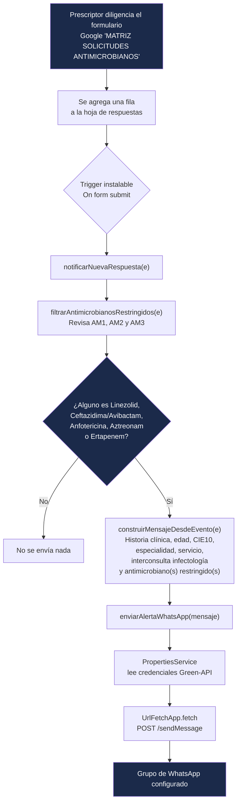

# Alertas WhatsApp - PROA Antimicrobianos Restringidos HDV

Bot de Google Apps Script que envía una alerta automática por **WhatsApp** (vía [Green-API](https://green-api.com/en/)) cada vez que se registra en el formulario Google "MATRIZ SOLICITUDES ANTIMICROBIANOS" la prescripción de uno de los antimicrobianos restringidos del Programa de Optimización de Antimicrobianos (PROA) del Hospital Departamental de Villavicencio E.S.E.

Es el tercer bot de esta familia (junto a los de Farmacovigilancia y Tecnovigilancia), reutilizando la misma instancia de Green-API pero con **Script Properties completamente independientes**, en un proyecto de Apps Script **standalone** separado del script existente de cálculo de DOT ("FORMULARIO PROA DOT") que ya está vinculado a la misma hoja de cálculo. Ambos proyectos conviven sin interferirse.

## Arquitectura

- **Tipo de proyecto:** Google Apps Script *standalone* (no vinculado directamente a la hoja). El activador se crea programáticamente vía `ScriptApp.newTrigger(...).forSpreadsheet(...)`, apuntando a la hoja de respuestas del formulario "MATRIZ SOLICITUDES ANTIMICROBIANOS".
- **Disparador (trigger):** instalable, tipo `On form submit` ("Al enviar el formulario"), apuntando a `notificarNuevaRespuesta(e)`.
- **Canal WhatsApp:** [Green-API](https://green-api.com/en/), instancia compartida `710722693364` con los bots de Farmacovigilancia y Tecnovigilancia (cada proyecto tiene su propio Script Properties, así que no hay colisión de configuración pese a compartir instancia).
- **Sin canal de correo:** a diferencia de los otros dos bots, este únicamente envía alertas por WhatsApp.
- **Filtro de negocio:** solo se envía alerta si alguno de los antimicrobianos formulados (AM1, AM2 o AM3) coincide con la lista de antimicrobianos restringidos monitoreados por PROA. Si ninguno coincide, la ejecución termina sin enviar nada.

## Diagrama de flujo



Resumen del recorrido: un prescriptor envía el formulario → se crea una fila nueva en la hoja de respuestas → el trigger instalable dispara `notificarNuevaRespuesta(e)` → se revisan los antimicrobianos formulados → **solo si alguno está en la lista restringida** se arma el mensaje y se envía por WhatsApp (Green-API); en caso contrario no se envía nada.

## Antimicrobianos restringidos monitoreados

1. Linezolid
2. Ceftazidima / Avibactam
3. Anfotericina (B o B liposomal)
4. Aztreonam
5. Ertapenem

La coincidencia se hace por prefijo del nombre (insensible a mayúsculas), ya que el formulario guarda el nombre seguido de un código interno (ej. `LINEZOLID - UT-19907394-3`); el código se descarta antes de comparar y antes de mostrarlo en el mensaje.

## Archivos

| Archivo | Descripción |
|---|---|
| `Codigo.gs` | Lógica completa del bot: filtro de antimicrobianos restringidos, construcción del mensaje, envío WhatsApp, creación del trigger, utilidades de prueba. |
| `appsscript.json` | Manifiesto del proyecto Apps Script (zona horaria, runtime V8). |
| `CLAUDE.md` | Reglas y contexto operativo para asistentes de IA que continúen este proyecto. |
| `CHANGELOG.md` | Historial de cambios. |
| `test/dry-run.js` | Script Node.js para probar el filtro y la construcción del mensaje **sin** llamar a ninguna API real (sin credenciales, sin envíos). |

## Campos que incluye la alerta

1. Número de Historia Clínica
2. Edad del paciente (en años, o en meses si años no está diligenciado)
3. Diagnóstico CIE10 para la cual se prescribe el antimicrobiano
4. Especialidad que prescribe
5. Servicio actual
6. ¿Solicitó interconsulta por infectología en Dinámica Gerencial?
7. Nombre, dosis (mg/UI) y frecuencia (horas) de cada antimicrobiano restringido detectado (AM1, AM2 y/o AM3)

El mensaje de WhatsApp usa emojis (vía `String.fromCodePoint`, no caracteres literales, para evitar corrupción de codificación en editores).

## Configuración necesaria (Script Properties)

En el proyecto de Apps Script ("PROA ALERTAS"), ir a **Configuración del proyecto → Propiedades de las secuencias de comandos** y definir:

| Propiedad | Descripción | Ejemplo |
|---|---|---|
| `GREENAPI_ID_INSTANCE` | ID de instancia de Green-API | `710722693364` |
| `GREENAPI_API_TOKEN` | Token de la instancia | *(secreto, no versionar)* |
| `GREENAPI_API_URL` | URL base de la API de esa instancia | `https://7107.api.greenapi.com` |
| `GREENAPI_GROUP_CHATID` | chatId del grupo de WhatsApp destino | grupo de pruebas "PRUEBA BOT" durante desarrollo |
| `GREENAPI_BOT_LABEL` | Firma que antecede el mensaje | `Bot PROA Antimicrobianos HDV` |

**Nunca** se deben hardcodear estas credenciales en el código: todo se lee vía `PropertiesService.getScriptProperties()`.

## Disparador (trigger)

Como el proyecto es standalone, el trigger **no** se puede crear desde la interfaz de Activadores (esa vista solo ofrece "Basado en el tiempo" o "Del calendario" para proyectos no vinculados). Se crea ejecutando una vez la función `crearTriggerFormSubmit()`, que registra un activador instalable `onFormSubmit()` contra la hoja de cálculo indicada en `CONFIG.SPREADSHEET_ID`.

## Funciones de utilidad / prueba

| Función | Uso | ¿Envía mensajes reales? |
|---|---|---|
| `listarChatsGreenAPI()` | Lista los chats/grupos visibles para la instancia (para obtener chatIds) | No, solo lectura |
| `testConstruccionMensaje()` | Construye el mensaje con dos casos ficticios (uno con antimicrobiano restringido, otro sin él) y lo muestra en el log | No |
| `eventoPruebaLinezolid()` | Datos ficticios con Linezolid (debe generar alerta) | No |
| `eventoPruebaSinRestringidos()` | Datos ficticios con Ceftriaxona (no debe generar alerta) | No |
| `enviarEjemploAlGrupo()` | Envía el mensaje de ejemplo (caso Linezolid) al grupo configurado | **Sí** |
| `crearTriggerFormSubmit()` | Crea el activador instalable `onFormSubmit` (una sola vez) | No |

⚠️ **Antes de ejecutar `enviarEjemploAlGrupo()`**, confirmar en `GREENAPI_GROUP_CHATID` que el chatId apunta al grupo de pruebas ("PRUEBA BOT") y no a un grupo de producción.

## Pruebas locales sin credenciales

```bash
node test/dry-run.js
```

Este script reconstruye la lógica de `filtrarAntimicrobianosRestringidos` y `construirMensajeDesdeEvento` en Node.js puro (sin `UrlFetchApp` ni `PropertiesService`) para verificar el filtro y el formato del mensaje antes de tocar el proyecto de Apps Script.

## Marco regulatorio de referencia

Programa de Optimización de Antimicrobianos (PROA), Resolución 4816 de 2008 (Farmacovigilancia/Tecnovigilancia), Resolución 3100 de 2019 — aplicable al programa institucional de PROA del HDV E.S.E.
