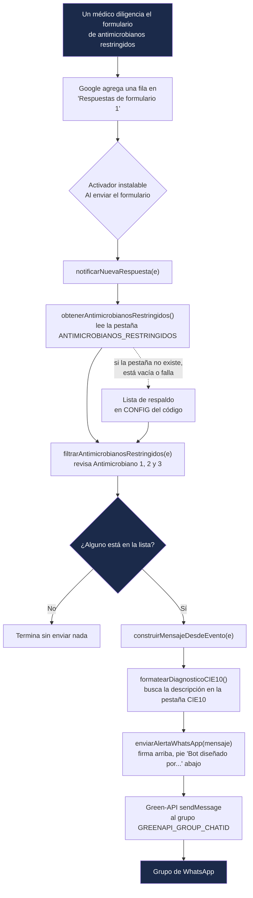

# Alertas WhatsApp - PROA Antimicrobianos Restringidos HDV

Bot de Google Apps Script que avisa por **WhatsApp** (vía [Green-API](https://green-api.com/en/)) cada vez que en el **FORMULARIO DE ANTIMICROBIANOS RESTRINGIDOS HDV** se prescribe uno de los antimicrobianos restringidos del Programa de Optimización de Antimicrobianos (PROA) del Hospital Departamental de Villavicencio E.S.E. (HDV). Si la solicitud no incluye ningún restringido, no envía nada. No envía correo.

| Recurso | Enlace |
|---|---|
| Formulario | [FORMULARIO DE ANTIMICROBIANOS RESTRINGIDOS HDV](https://docs.google.com/forms/d/1u8XYmynHfAH0EoeyNFFcd8w12IA95J47oItrv34TyGI/edit) |
| Hoja de respuestas | [MATRIZ FORMULARIO DE ANTIMICROBIANOS RESTRINGIDOS HDV (Respuestas)](https://docs.google.com/spreadsheets/d/1ZsjuygpRz1wPhCRxmL8LPLTNOo8kujGXplX8JRs6SZY/edit) |
| Proyecto Apps Script | [PROA ALERTAS](https://script.google.com/u/1/home/projects/12mUy9SqQGzRnGjkbAsFyycG9RxJxvFePpSuHl4Nv8MokONxKY7kwbIw0/edit) (independiente, no vinculado a la hoja; archivo "Código") |
| Código en este repo | `Codigo.gs` (archivo "Código") e `IA_PROA.gs` (archivo "IA_PROA": informe semanal PROA con lectura de la IA, v1.34.0; no cambia los mensajes de cada solicitud) |

La misma hoja tiene vinculado otro script, **FORMULARIO PROA DOT**, que calcula los días de terapia. Son proyectos separados y este bot no lo toca.

## Cómo funciona



Paso a paso:

1. **Llega una solicitud.** Al enviarse el formulario, Google agrega una fila a la hoja y dispara el activador "Al enviar el formulario", que llama a `notificarNuevaRespuesta(e)`.
2. **Se carga la lista de restringidos** desde la pestaña `ANTIMICROBIANOS_RESTRINGIDOS` de la misma hoja (columna A, desde la fila 2). Si esa pestaña no existe, está vacía o falla la lectura, se usa `CONFIG.ANTIMICROBIANOS_RESTRINGIDOS_RESPALDO`, para que las alertas nunca dejen de funcionar por eso.
3. **Se revisan los 3 antimicrobianos de la solicitud.** El formulario guarda el nombre con un código interno (`ERTAPENEM - UT-19973898-1`). `nombreLimpio()` quita todo desde ` - UT-` y la presentación (`AMPOLLA 100, 200`, `50, 70`, `TABLETA`…; v1.29.1), se pasa a mayúsculas y se marca como restringido si el nombre **contiene** alguno de la lista. Por eso `CASPOFUNGINA` cubre `CASPOFUNGINA 50, 70`, y `ANFOTERICINA` cubre la convencional y la liposomal.
4. **Si ninguno es restringido, termina** sin enviar nada. Es lo más común: la mayoría de solicitudes son de cefepime, piperacilina/tazobactam, meropenem, etc. **`📆 REVISIÓN DE DURACIÓN DE TTO` (v1.27.0, antes "tratamiento prolongado"; solo si la solicitud no genera caso PROA, que ya trae la lista).** Si la solicitud es la **3.ª o más del mismo tratamiento continuo** y el paciente ya lleva **más de 10 días** (sumando los cambios entre fármacos, `seguimientoPaciente()`), la revisión sale **al llegar la solicitud** y queda en `REGISTRO_REVISIONES`: **un mensaje corto por paciente** (para que WhatsApp no lo corte con "Leer más"), con los días en negrita, cada solicitud con fechas, días y patología, y el total frente a la referencia de la patología más larga. Sin verdes y un paciente como máximo cada 7 días: no sale si el paciente tuvo caso PROA o revisión en los últimos 7 días (v1.36.14). Si el paciente tiene antimicrobianos de formularios anteriores que aún están dentro de sus días ordenados y no están en esta orden, se informan en una línea `💉 Formulado antes y aún dentro de sus días` (también en el caso PROA), sin cambiar los días.
5. **Si hay al menos uno, arma el mensaje.** Además de historia clínica, edad y servicio, incluye lo que PROA interviene: peso y **mg/kg por dosis**, cama, indicación (empírico/etiológico/profiláctico), cultivos, origen (IAAS/comunidad), si fue un cambio de antimicrobiano y por qué, ajuste renal con depuración de creatinina, y un aviso cuando **no se pidió interconsulta a Infectología**. El diagnóstico se busca en la pestaña `CIE10` por su código (`G06.0` → `G060 - ABSCESO…`; `J40` → `J40X`). Si el médico no escribió código, se cruza el texto con las descripciones de la pestaña (v1.35.0, ver "Cruce del diagnóstico con la pestaña CIE10"); si tampoco así aparece, deja lo que escribió el médico. Cada antimicrobiano restringido va con dosis, vía, frecuencia, días y **fecha fin prevista**; si la dosis queda fuera del rango de referencia de la pestaña `RANGOS_DOSIS`, se agrega `⚠️ … revisar`. Los antimicrobianos **no** restringidos de la misma solicitud salen como "Acompañante", para ver la combinación completa.
6. **WhatsApp.** `enviarAlertaWhatsApp()` pone la firma en negrita arriba (`Bot PROA Antimicrobianos HDV` o lo que diga `GREENAPI_BOT_LABEL`) y el pie en cursiva abajo, y hace un `POST` a `sendMessage` de Green-API. Si Green-API responde con error o no hay conexión, lo deja en el registro sin detener la ejecución.

### Antimicrobianos restringidos

La lista vigente está en la pestaña **`ANTIMICROBIANOS_RESTRINGIDOS`** de la matriz:

Ceftazidima / Avibactam · Anfotericina · Aztreonam · Ertapenem · Caspofungina · Anfotericina B liposomal · Tygeciclina · Doripenem · Rifampicina · Polimixina B · Daptomicina

> **Vancomicina y linezolid no disparan alerta por sí solas** desde el 2026-11-02 (eran el 73 % y el 9 % de las alertas de octubre). Siguen siendo restringidas: si otro antimicrobiano de la misma solicitud dispara la alerta (p. ej. ceftazidima/avibactam en el primero y vancomicina en el segundo), vancomicina sale como "Antimicrobiano restringido 2" con su dosis evaluada, no como acompañante.
>
> Esto se controla con la columna **`dispara_alerta`** (SI/NO, vacío = SI) de la pestaña `ANTIMICROBIANOS_RESTRINGIDOS`. Si la pestaña no tiene esa columna, el código agrega las moléculas de `CONFIG.RESTRINGIDOS_SIN_ALERTA_PROPIA` (vancomicina, linezolid) con NO.
>
> **Desde la v1.28.0 el caso PROA sale solo si el tratamiento continuo del restringido, contando los días de esta orden, supera 14 días** (`CONFIG.CASO_DIAS_MINIMOS`; 0 = en cada solicitud, como antes). Una primera orden de 21 d sale; una de 7 d no; si lleva 10 d y piden 7 más (17 d), sale. Los antimicrobianos que no están en el listado (o no disparan alerta) solo reciben la `📆 REVISIÓN DE DURACIÓN DE TTO`. Para que vuelvan a disparar alerta: escribirlas en la pestaña con `SI` en la columna B.

**Para agregar o quitar un antimicrobiano no hay que tocar el código:** basta con editar esa pestaña, una fila por antimicrobiano. Hay que escribirlo como aparece en el formulario (por ejemplo `TYGECICLINA` con Y). Ojo con nombres muy cortos o genéricos: como la comparación es por "contiene", un término como `CEF` alertaría por todas las cefalosporinas.

Si se cambia la lista de la pestaña, conviene actualizar también la de respaldo en `CONFIG` (y en `test/dry-run.js`), para que coincidan si alguna vez falla la lectura.

### Datos del mensaje

**Formato simple (v1.32.0).** Revisión de duración: paciente, diagnóstico, `⏱️` días que lleva y con esta orden, el motivo del color (la duración de referencia contra la que se compara), la lista de prescripciones sin códigos y, si un antimicrobiano se repite, los días por antimicrobiano. Caso PROA: un solo encabezado, las prescripciones anteriores a esta orden, el total con esta orden y los antimicrobianos en curso. Frecuencias de menos de 4 h salen con `⚠️ Verificar frecuencia`.

Desde la v1.23.0 el caso PROA va **solo con datos** (`CONFIG.CASO_ANALISIS = false`): título, `📍` servicio y cama, `📋` diagnóstico, `📄` HC, edad, peso y especialidad, `🦠` aislamiento, cultivos, indicación y origen, interconsulta, cada antimicrobiano con los días en negrita y la lista numerada de prescripciones del tratamiento continuo con su total. Sin veredicto ni pertinencia de las tablas (el análisis de las tablas queda en `REGISTRO_REVISIONES`). La IA no interviene en estos mensajes: solo escribe la lectura del informe semanal (sección siguiente).

| En el mensaje | Pregunta del formulario (título exacto) |
|---|---|
| 📄 Historia Clínica | `Número de Historia Clínica` |
| 🎂 Edad | `Edad del paciente en años` + `Edad del paciente meses`; si ambos vacíos, `Edad del paciente días` |
| ⚖️ Peso | `Peso en Kg`; si es 0 o vacío, `Peso en gr` ÷ 1000 |
| 🏥 Servicio · Cama | `Servicio actual`, `Numero de cama` |
| 🩺 Especialidad que prescribe | `Especialidad que prescribe` |
| 📋 Diagnóstico CIE10 | `Diagnóstico CIE10 para la cual se prescribe el antimicrobiano` (+ descripción de la pestaña `CIE10`) |
| 🦠 Microorganismo aislado | `Microorganismo aislado` |
| 🧫 Indicación · Cultivos · Origen | `Indicación del antibiótico` (resumida a Empírico/Etiológico/Profiláctico), `Cultivos tomados:`, `Origen de la infección?` |
| 🔄 Cambio de antimicrobiano (solo si aplica) | `Indicación` = CAMBIO, con `Si fue cambiado, cual fue la razón?` |
| 🧪 Interconsulta / ⚠️ Sin interconsulta | `¿Solicitó interconsulta por infectología en Dinámica Gerencial?` |
| 💧 Ajuste renal · Falla hepática (solo si Sí) | `Ajuste Renal`, `…depuración de Creatinina…`, `Falla Hepática` |
| 💊 Antimicrobiano restringido | `Nombre Antimicrobiano 1/2/3` con dosis (+ mg/kg), vía, frecuencia, días y fecha fin (hoy + días) |
| ⚠️ Dosis fuera del rango (solo si aplica) | Pestaña `RANGOS_DOSIS` |
| ➕ Acompañante | Los antimicrobianos de la solicitud que no son restringidos |
| 📏 Duración de referencia / ⚠️ Superan la referencia / ⚠️ Espectro (solo con `CASO_ANALISIS = true`; apagado desde la v1.23.0) | Pertinencia: duración por síndrome (pestaña `PERTINENCIA_DURACION`, por CIE10 o palabra clave), profilaxis > 24 h, reglas de espectro (`CONFIG.REGLAS_ESPECTRO`) e indicación etiológica sin aislamiento. Detalle y fuentes en `docs/pertinencia.md` |
| ⚠️ Verificar peso / dosis (solo si aplica) | Incoherencias de digitación: peso fuera de 0,4–250 kg, peso < 20 kg con ≥ 12 años o < 30 kg con ≥ 18 años, > 20 kg con menos de 12 meses, o más de 100 mg/kg por dosis |
| 💡 Sugerencia PROA (solo si aplica) | Terapia empírica con un restringido más un acompañante de amplio espectro (`AMPLIO_ESPECTRO`: meropenem, imipenem, cefepime, piperacilina/tazobactam, ceftazidima, ceftriaxona): "Revaluar a las 48-72 h con el resultado de cultivos para desescalar" (intervención *time-out*, guía OPS/OMS 2024). `SUGERENCIA_EMPIRICO_SOLO = true` la extiende a toda terapia empírica |

Los títulos exactos están en `CAMPOS` y `SLOTS` de `Codigo.gs` y se leen con `campoDelEvento()`, que tolera espacios sobrantes en el título. Aun así, los nombres deben coincidir: la dosis del primero dice `AB1` y las otras `AM2`/`AM3`; la frecuencia del primero `(En Horas)` y las otras `(En horas)`; la vía dice `adminsitración` con dos espacios antes de `AM1`. Si alguien edita una pregunta, ejecutar `verificarEncabezados()` (solo lectura) muestra cuál dejó de encontrarse.

La columna `TERMINACION` de la hoja es una fórmula y no llega con el formulario; el bot calcula la fecha fin como fecha de envío + días ordenados.

### Ejemplo (datos ficticios)

```
*Bot PROA Antimicrobianos HDV*

🚨 NUEVO CASO PROA - ANTIMICROBIANO RESTRINGIDO 🚨

📄 Historia Clínica: 88888888
🎂 Edad: 63 años · ⚖️ Peso: 70 kg
🏥 Servicio: Unidad de Cuidado Crítico UCI B · Cama: B07
🩺 Especialidad que prescribe: Medicina Interna
📋 Diagnóstico CIE10: N390 - INFECCION DE VIAS URINARIAS, SITIO NO ESPECIFICADO
🦠 Microorganismo aislado: Klebsiella pneumoniae KPC
🧫 Indicación: Empírico · Cultivos: UROCULTIVO · Origen: IAAS
🔄 Cambio de antimicrobiano: Por antibiograma
⚠️ Sin interconsulta a Infectología
💧 Ajuste renal: Sí (DepCr 18)

💊 Antimicrobiano restringido 1: CEFTAZIDIMA / AVIBACTAM
   Dosis: 750 mg (10,7 mg/kg) · Intravenoso · cada 12 horas
   Días ordenados: 14 días · hasta 16/11/2026
   ⚠️ Dosis fuera del rango de referencia (940-2500 mg/dosis o 30-65 mg/kg/dosis): revisar

➕ Acompañante: MEROPENEM · 1000 mg (14,3 mg/kg) · Intravenoso · cada 8 horas · 7 días · hasta 09/11/2026

💡 Sugerencia PROA: terapia empírica combinada (CEFTAZIDIMA / AVIBACTAM + MEROPENEM). Revaluar a las 48-72 h con el resultado de cultivos para desescalar.

_Ecosistema de Vigilancia Digital del Servicio Farmacéutico HDV · Desarrollado por el QF Juan Pablo Saavedra_
```

### Informe semanal PROA (IA, v1.34.0)

La IA ya **no opina caso por caso** (decisión del referente: el caso lo valora Infectología). Su papel es el informe del programa: los **lunes a las 7:00** (hora de Colombia) el bot envía un mensaje con las cifras de los 7 días anteriores y, debajo, una lectura corta escrita por Claude (modelo Opus, `claude-opus-5-5`).

- **Las cifras las calcula el código**, no la IA, a partir de todas las solicitudes del formulario (no solo restringidos): solicitudes, pacientes y solicitudes con restringido (frente a la semana anterior); **mediana de días de tratamiento por antimicrobiano** (por paciente, solo los días de ese antimicrobiano; v1.36.2) con el número de pacientes, p. ej. `CEFEPIME 9 d (49)`. Con pocos pacientes, un tratamiento muy largo no la mueve. `INFORME_MEDIDA = "promedio"`, al inicio de `IA_PROA.gs`, cambia a promedio. Restringidos con la misma medida; servicios; empírico, etiológico y profiláctico (con el % de empíricos sin cultivos); profilaxis de más de 1 día; interconsulta a Infectología en restringidos y los **tratamientos más largos**.
- **Cómo se cuentan los días** (mismas reglas que el "⏱️ Con esta orden: N d" del caso PROA): para cada paciente con alguna orden en la semana se toma su última orden de la semana y se retrocede por sus órdenes anteriores (hasta 60 días): una orden anterior es parte del mismo tratamiento si termina (fecha + días ordenados + 3 días de tolerancia) en o después del inicio ya encontrado, y entonces el inicio se corre hacia atrás. Los días son los días calendario desde ese inicio hasta el fin de la última orden (incluye los días que faltan por administrar). En **Más largos** se suma el tratamiento continuo aunque cambie de antimicrobiano (antibacterianos y antifúngicos por separado; se muestra el mayor de cada paciente, los 3 mayores de la semana, con el servicio de su última orden); en el promedio por antimicrobiano, solo las órdenes de ese antimicrobiano.
- **La IA solo escribe la lectura:** 2 a 4 hallazgos y hasta 2 sugerencias de programa para el comité (educación, auditoría de una molécula, protocolo, formulario), nunca sobre un paciente.
- **El código revisa cada frase de la IA.** Descarta la que traiga una cifra que no esté en los datos (la IA no puede calcular ni inventar números) y la que tenga lenguaje de juicio ("inadecuado", "abuso", "mal uso"…). Lo descartado queda en la pestaña `INFORMES_PROA` con el motivo.
- A la API **solo salen cifras agregadas**: sin historia clínica, nombres, camas ni médicos. Las HC de los tratamientos largos las pone el código en el mensaje y no van a la API.
- Sin `ANTHROPIC_API_KEY`, o si la API falla, el informe sale igual, solo con las cifras.
- Destino: `INFORME_PROA_DESTINO` vacío = **PRUEBA BOT**; `PRODUCCION` = grupo PROA.
- Costo estimado: unos USD 0,05–0,15 por informe, menos de USD 1 al mes.

Ejemplo con datos ficticios:

```
*📊 INFORME SEMANAL PROA · 16/11–22/11*
📝 6 solicitudes (sem. ant. 3) · 5 pacientes
💊 Mediana de días de tratamiento por antimicrobiano (pacientes): ERTAPENEM 7 d (3) · CASPOFUNGINA 14 d (1) · MEROPENEM 7 d (1) · VANCOMICINA 7 d (1)
🔒 Restringidos: ERTAPENEM 7 d (3) · CASPOFUNGINA 14 d (1) · VANCOMICINA 7 d (1)
🏥 Servicios: UCI A 67% · Hosp. Medicina Interna 17% · Cirugía 17%
🧫 Empírico 50% (67% sin cultivos) · Etiológico 33% · Profiláctico 17% · 1 con profilaxis de más de 1 día
🧪 Restringidos con interconsulta a Infectología: 50%
⏳ Más largos: HC 1001 UCI A *18 d* · HC 1002 Hosp. Medicina Interna *16 d* · HC 1004 UCI A *14 d*

*🤖 Lectura de la semana (IA)*
• UCI A concentró el 67% de las solicitudes de la semana
• Ertapenem tuvo una mediana de 7 días en 3 pacientes
*Para el comité*
• Revisar con UCI A la toma de cultivos antes del tratamiento empírico
_Cifras del formulario; lectura automática para el comité PROA_
```

Los promedios son de días ordenados (hasta el fin de la última orden), no de días de terapia administrados. El DOT lo sigue calculando el script FORMULARIO PROA DOT.

La IA no escribe su razonamiento en la respuesta: el modelo declina ese pedido (`reasoning_extraction`). El resumen de su razonamiento se lee de los bloques de *thinking* (`display: "summarized"`) y queda en `INFORMES_PROA`.

Para activarlo: crear el archivo `IA_PROA` en el proyecto, pegar `IA_PROA.gs`, agregar `ANTHROPIC_API_KEY` en Propiedades del script, revisar el informe con `probarInformeProa()` (no envía nada) y ejecutar una vez `crearTriggerInformeProa()`.

### Indicador mensual

El día 1 de cada mes a las 7:00, al mismo destino del informe semanal, el bot envía las solicitudes del mes que terminó cuya razón del cambio es **"POR INTERVENCIÓN PROA"** (la marca el médico en "Si fue cambiado, ¿cuál fue la razón?"): número, total de solicitudes y porcentaje de ese mes, y la tendencia de 6 meses. Lo calcula el código, sin IA. Es una cifra que se queda corta: la pregunta es obligatoria, la mayoría responde "Condición propia del paciente" y una suspensión no genera formulario. Prueba sin enviar nada: `probarIndicadorMensual()`.

### Cruce del diagnóstico con la pestaña CIE10 (v1.35.0)

Cuando el médico escribe el diagnóstico sin código (en la matriz, uno de cada cinco), el bot busca sus palabras en las descripciones de la pestaña `CIE10`:

- **Abreviaturas** (`CONFIG.CIE10_SINONIMOS`): ITU/IVU, SHOCK, SX, ISO, NAC, CA, TBC, ERC/IRC, EPOC.
- **Errores de digitación:** una letra de diferencia, dos en palabras largas, contra el vocabulario de la pestaña. MENIGITIS → MENINGITIS, PERITONISTIS → PERITONITIS, ENFEREMDAD → ENFERMEDAD.
- **Palabras que no cambian el diagnóstico** (`CONFIG.CIE10_PALABRAS_IGNORADAS`): en estudio, probable, derecha, adquirida en la comunidad, asociada a los cuidados de la salud…
- **Equivalencias fijas** (`CONFIG.CIE10_EQUIVALENCIAS`), que van primero: neumonía aspirativa o por broncoaspiración → J690, síndrome febril → R509, pielonefritis → N10X, bacteremia/bacteriemia → A499 (la CIE-10 de la OMS no tiene código de bacteriemia). El código debe existir en la pestaña.
- **Para no inventar un diagnóstico:**
  - con dos o más palabras, la descripción debe contenerlas todas; si ninguna las tiene, se quita **una** del final ("INFECCION DE VIAS URINARIAS COMPLICADA" → N390);
  - al final, solo la primera palabra y solo con su descripción genérica ("NEUMONIA" → J189; "CELULITIS DE PIERNA DERECHA" → L039);
  - entre varias, la "no especificada" antes que "otras" (G009, no G008 "Otras meningitis bacterianas");
  - **si dos descripciones empatan, queda sin código** ("Tumor de mama": benigno o maligno).

  Así "ACCIDENTE OFIDICO" no termina en un accidente cerebrovascular, ni "NEUTROPRENIA FEBRIL" en la dermatosis neutrófila febril, ni "TUMOR FOSA POSTERIOR" en la fosa nasal (casos reales de la primera prueba).
- **En el mensaje se ve lo que escribió el médico:** `📋 G039 · Meningitis, no especificada (escrito: menigitis)`.
- **Duración de referencia:** con código cruzado mandan primero las palabras clave de la tabla de duración ("SEPSIS URINARIA" sigue siendo infección urinaria) y, si ninguna coincide, el código cruzado. Con código escrito por el médico no cambia nada.
- Un código de 3 caracteres sin subcódigo (`K35`, `K65`) sale con la descripción de su "no especificada".

La pestaña se lee una vez por ejecución, y solo cuando hace falta. El resultado de cada texto queda 6 h en caché. `probarCruceCIE10(filas)` revisa los diagnósticos de las últimas solicitudes (500 por defecto) sin enviar nada: cuántos traen código, cuáles se cruzaron (para revisar) y cuáles quedaron sin código, cada uno con la duración de referencia que le toca.

### Rangos de dosis (`⚠️ revisar`)

La pestaña **`RANGOS_DOSIS`** de la matriz tiene una fila por antimicrobiano con `min_mg_kg_dosis`, `max_mg_kg_dosis`, `min_mg_dosis`, `max_mg_dosis`, `ajuste_renal` (SI/NO; si el prescriptor marca ajuste renal y la molécula no lo requiere, el mensaje lo dice) y `nota` con la fuente del rango (ficha FDA/EMA, consenso de vancomicina 2020, consenso de polimixinas 2019, IDSA 2024; detalle en `docs/antimicrobianos-restringidos.md`). Una dosis se acepta si cumple **cualquiera** de las reglas definidas para su molécula (así, 600 mg de linezolid en un adulto de 100 kg no marca aunque sean 6 mg/kg); solo se marca si falla en todas. Sin peso no se evalúa mg/kg; si una molécula no tiene reglas (Polimixina B, cuya dosis puede venir en UI) nunca se marca.

`crearHojaRangosDosis()` crea la pestaña con la propuesta inicial que trae el código y `reescribirHojaRangosDosis()` la reemplaza por la tabla del código cuando esta cambia (borra lo editado a mano en la pestaña); **la propuesta es una referencia y la debe validar y ajustar el QF**. Mientras la pestaña no exista, se usa la misma tabla desde el código. Para cambiar un rango basta editar la celda; no hay que tocar el código. Réplica sobre las 148 alertas de octubre de 2026: 16 marcadas (11%), casi todas vancomicina 500 mg en adultos de 60–70 kg y errores de digitación evidentes (1.000 mg con peso 1 kg).

## Configuración

### En el código (`CONFIG`)

| Clave | Valor |
|---|---|
| `SPREADSHEET_ID` | ID de la matriz de respuestas |
| `HOJA_ANTIMICROBIANOS_RESTRINGIDOS` | `ANTIMICROBIANOS_RESTRINGIDOS` |
| `ANTIMICROBIANOS_RESTRINGIDOS_RESPALDO` | Lista de respaldo |
| `HOJA_CIE10` | `CIE10` (columna A código, columna B descripción); se consulta por celda y se guarda en caché 6 h (`CACHE_CIE10_SEG`) |
| `HOJA_RANGOS_DOSIS` / `RANGOS_DOSIS_RESPALDO` | Pestaña y tabla de respaldo de rangos de dosis |
| `HOJA_RESPUESTAS` | `Respuestas de formulario 1` (solo la usa `verificarEncabezados()`) |
| `CAMPOS` / `SLOTS` | Títulos exactos de las preguntas del formulario |
| `PROLONGADO_ACTIVO` / `PROLONGADO_DIAS` / `PROLONGADO_MIN_SOLICITUDES` | Revisión por tratamiento prolongado (mensaje aparte): `true` / `10` (más de 10 días ya recibidos) / `3` (3.ª solicitud o más del tratamiento continuo, contando la actual) |
| `PROLONGADO_ENVIAR_VERDES` / `PROLONGADO_REPETIR_DIAS` | `false` (no se envían las que están dentro de la referencia) / `7` (no hay revisión si el paciente tuvo caso PROA o revisión en los últimos 7 días) |
| `AJUSTE_RENAL_ACTIVO` / `AJUSTE_RENAL_ENVIAR` | `true` / `false`: revisión de ajuste renal (Cockcroft-Gault con la pregunta `Creatinina sérica (mg/dL)`) en **modo prueba**, solo en `REGISTRO_REVISIONES` (fuente `AJUSTE RENAL`). Tabla `AJUSTE_RENAL` en `docs/ajuste-renal.md`, pendiente de validación del comité |
| `PROLONGADO_EXCLUIDOS` | `['VANCOMICINA', 'LINEZOLID']`: no generan la revisión de duración por sí solos (sus días sí cuentan) |
| `PROLONGADO_SOLO_CAMBIO` | `false`: revisa toda orden nueva (cambio o renovación); `true`: solo cuando se formula un antimicrobiano que el paciente no venía recibiendo |

### Propiedades del script

En el editor de Apps Script: **Configuración del proyecto → Propiedades del script**. Ninguna credencial va en el código: este repositorio es público.

| Propiedad | Obligatoria | Descripción |
|---|---|---|
| `GREENAPI_ID_INSTANCE` | sí | ID de la instancia de Green-API (compartida con los otros bots) |
| `GREENAPI_API_TOKEN` | sí | Token de la instancia (secreto) |
| `GREENAPI_API_URL` | sí | URL base de la API, ej. `https://7107.api.greenapi.com` |
| `GREENAPI_GROUP_CHATID` | sí | chatId del grupo de destino; siempre termina en `@g.us` |
| `GREENAPI_BOT_LABEL` | no | Firma en negrita al inicio del mensaje (por defecto `Bot PROA Antimicrobianos HDV`) |

Informe semanal PROA (`IA_PROA.gs`):

| Propiedad | Obligatoria | Descripción |
|---|---|---|
| `ANTHROPIC_API_KEY` | para la lectura de la IA | Clave de la API de Claude (secreto). Sin ella el informe sale solo con las cifras |
| `INFORME_PROA_DESTINO` | no | Vacío o `PRUEBA`: el informe va a PRUEBA BOT. `PRODUCCION`: al grupo PROA |
| `IA_ESFUERZO` | no | `low`, `medium`, `high` (por defecto), `xhigh` o `max`. Si la API tarda demasiado con esfuerzo alto, el bot reintenta una vez con `medium` |
| `CLAUDE_MODEL` | no | Modelo; por defecto `claude-opus-5-5` |
| `GREENAPI_PRUEBA_CHATID` | no | Grupo de prueba; por defecto PRUEBA BOT. Debe terminar en `@g.us` |

`IA_PROA_MODO` (de la v1.33.0) ya no se lee y se puede borrar.

Para encontrar el chatId de un grupo sin riesgo de enviar nada, ejecutar `listarChatsGreenAPI()`: solo lee (`getChats`) y registra los grupos (`@g.us`).

## Versión

`VERSION_BOT` (al inicio de `Codigo.gs`) y `VERSION_INFORME` (al inicio de `IA_PROA.gs`) comparten mayor.menor (p. ej. 1.36). Un cambio en los dos archivos sube la menor y se pegan juntos. Un cambio en uno solo sube su último número y basta con pegar ese archivo. `probarUltimaSolicitud()`, `probarCruceCIE10()` y `probarInformeProa()` escriben la versión en el registro de ejecución, y la pestaña `INFORMES_PROA` la guarda en la columna `Versión`. Si mayor.menor no coincide, el bot lo avisa. Una prueba local comprueba que el `CHANGELOG.md` empiece por la mayor de las dos versiones.

## Activador

El proyecto es independiente (no está vinculado a la hoja), así que el activador "Al enviar el formulario" **no** se puede crear desde la pantalla de Activadores. Se creó una sola vez ejecutando `crearTriggerFormSubmit()`. No volver a ejecutarla: crearía un segundo activador y cada alerta llegaría duplicada.

El informe semanal (lunes a las 7:00) y el indicador mensual (día 1 a las 7:00) tienen sus propios activadores, que se crean con `crearTriggerInformeProa()`. Esa función sí se puede repetir: borra los anteriores antes de crear los nuevos.

## Funciones

| Función | ¿Envía algo? | Uso |
|---|---|---|
| `notificarNuevaRespuesta(e)` | Sí, si hay restringido y, aparte, si hay tratamiento prolongado | La llama el activador |
| `obtenerAntimicrobianosRestringidos()` | **No** | Lee la pestaña de restringidos (o el respaldo) |
| `obtenerRangosDosis()`, `evaluarDosis()` | **No** | Lee la pestaña `RANGOS_DOSIS` (o el respaldo) y evalúa cada dosis |
| `crearHojaRangosDosis()` | No (escribe en la hoja) | Crea la pestaña `RANGOS_DOSIS` con la propuesta inicial; no la toca si ya existe |
| `reescribirHojaRangosDosis()` | No (escribe en la hoja) | Reemplaza la pestaña `RANGOS_DOSIS` por la tabla del código (pierde lo editado a mano) |
| `evaluarPertinencia()`, `sindromePara()`, `obtenerPertinencia()` | **No** | Duración de referencia y reglas de espectro |
| `crearHojaPertinencia()`, `reescribirHojaPertinencia()` | No (escriben en la hoja) | Crean o reemplazan la pestaña `PERTINENCIA_DURACION` |
| `advertenciasCoherencia()`, `sugerenciaPROA()` | **No** | Avisos de digitación y sugerencia de revaluación a las 48-72 h |
| `filtrarAntimicrobianosRestringidos(e)`, `debeAlertar()`, `acompanantesNoRestringidos(e)` | **No** | Separan los antimicrobianos de la solicitud y deciden si la alerta se envía (algún restringido con `dispara_alerta` ≠ NO) |
| `construirMensajeDesdeEvento(e)` | **No** | Arma el texto del mensaje |
| `tratamientoProlongado(e)`, `revisionProlongado(e)` | **No** | Detectan la revisión por tratamiento prolongado (≥ 3 solicitudes seguidas y > 10 d) y arman su mensaje |
| `notificarTratamientoProlongado(e)` | Sí, si la revisión sale | La llama `notificarNuevaRespuesta(e)` después del caso PROA |
| `inicioTratamientoContinuo()`, `diasTratamientoPrevio()`, `diaCalendario()` | **No** | La regla del tratamiento continuo (prescripciones seguidas, 3 d de tolerancia, 60 d hacia atrás, días calendario); la usan los mensajes y el informe semanal |
| `probarUltimaSolicitud(fila)`, `probarUltimoProlongado()` | **No** | Escriben en el registro de ejecución los mensajes de una fila real (o de la última que alerta / la última con revisión por tratamiento prolongado) |
| `enviarInformeSemanalProa()` (`IA_PROA.gs`) | Sí (según `INFORME_PROA_DESTINO`) | La llama el activador de los lunes: informe de los 7 días anteriores; deja una fila en `INFORMES_PROA` |
| `probarInformeProa(dias)` (`IA_PROA.gs`) | **No** (llama a la API si hay clave) | Escribe en el registro de ejecución el informe de los últimos `dias` días (7 por defecto) |
| `enviarInformeAPruebaBot(dias)` (`IA_PROA.gs`) | Sí, solo a PRUEBA BOT | El informe tal como llega a WhatsApp |
| `crearTriggerInformeProa()` (`IA_PROA.gs`) | No (crea los activadores) | Crea o recrea el activador de los lunes y el del día 1 de cada mes, a las 7:00; solo toca los de `enviarInformeSemanalProa` y `enviarIndicadorMensualProa` |
| `enviarIndicadorMensualProa()` (`IA_PROA.gs`) | Sí (según `INFORME_PROA_DESTINO`) | La llama el activador del día 1: solicitudes "POR INTERVENCIÓN PROA" del mes que terminó; deja una fila en `INFORMES_PROA` |
| `probarIndicadorMensual()` (`IA_PROA.gs`) | **No** | Escribe en el registro de ejecución el indicador del último mes cerrado y la cifra parcial del mes en curso |
| `enviarIndicadorMensualAPruebaBot()` (`IA_PROA.gs`) | Sí, solo a PRUEBA BOT | El indicador mensual tal como llega a WhatsApp |
| `formatearDiagnosticoCIE10()`, `buscarDescripcionCIE10()`, `resolverCIE10()`, `cruceCIE10PorTexto()` | **No** | Cruce del diagnóstico con la pestaña `CIE10`: por código (TextFinder + caché) y, sin código, por palabras |
| `probarCruceCIE10(filas)` | **No** | Escribe en el registro de ejecución cómo se cruzan los diagnósticos de las últimas solicitudes |
| `verificarEncabezados()` | **No** | Comprueba que todas las preguntas usadas existan en la fila 1 de la hoja |
| `enviarAlertaWhatsApp(mensaje)` | Sí | Envío a Green-API con firma y pie |
| `listarChatsGreenAPI()` | **No** | Lista los grupos visibles para la instancia |
| `crearTriggerFormSubmit()` | No (crea el activador) | Ya se ejecutó; no repetir |
| `eventoPruebaDaptomicina()`, `eventoPruebaCeftazidimaAvibactam()`, `eventoPruebaPediatrico()`, `eventoPruebaVancomicinaSola()`, `eventoPruebaSinRestringidos()` | **No** | Datos ficticios de prueba |
| `testConstruccionMensaje()` | **No** | Escribe en el registro los 3 mensajes de prueba (y confirma que ceftriaxona no alerta) |
| `testCruceCIE10()` | **No** | Verifica en el registro el cruce con la pestaña `CIE10` (incluye `G06.0` y `J40`) |
| `enviarPruebaCeftazidimaAPruebaBot()` | Sí, solo a PRUEBA BOT | El caso ficticio de ceftazidima/avibactam tal como llega a WhatsApp |

`enviarEjemploAlGrupo()` se retiró en la v1.36.12: enviaba un caso ficticio al grupo de `GREENAPI_GROUP_CHATID`, que es el de producción. Las pruebas que envían algo van solo a PRUEBA BOT, con el chat fijo en el código.

## Cómo se actualiza el bot

El editor de Apps Script **no** se sincroniza con GitHub. Para cambiar el bot:

1. Si solo cambia la lista de antimicrobianos o un rango de dosis, editar la pestaña `ANTIMICROBIANOS_RESTRINGIDOS` o `RANGOS_DOSIS`; no hace falta tocar el código.
2. Para cambios de código, editar `Codigo.gs` en este repo y correr las pruebas locales.
3. Copiar el cambio al editor (archivo "Código" del proyecto PROA ALERTAS, y "IA_PROA" si cambió `IA_PROA.gs`) y guardar con Ctrl+S. No hace falta publicar: el activador usa siempre la última versión guardada.
4. Ejecutar `verificarEncabezados()` y `testConstruccionMensaje()` (no envían nada) y luego probar con `GREENAPI_GROUP_CHATID` en PRUEBA BOT antes de volver a producción.

Al pegar texto con tildes o emojis, el editor a veces los daña. Los textos nuevos se escriben con escapes `\u` (como el pie) o con `String.fromCodePoint()`.

## Pruebas locales (sin red ni credenciales)

```bash
node test/dry-run.js     # carga Codigo.gs e IA_PROA.gs reales con la hoja y las API simuladas: filtro, mensajes, seguimiento, revisión de duración e informe semanal
node test/pie-firma.js   # pie de firma y filtro de los antimicrobianos nuevos
```

## Green-API compartida: cuidado con el cupo de chats

La instancia de Green-API es la misma para los 4 bots del Servicio Farmacéutico y está en el plan Developer (gratis). Ese plan **no limita mensajes, sino chats distintos por mes: 3**, contando los que escriben al número del bot; el contador se reinicia el día 1. Hoy se usan 2 (grupo de producción y PRUEBA BOT). Si se escribe a un cuarto chat, o alguien le escribe por privado al número del bot, Green-API responde 466 y **los 4 bots** dejan de enviar hasta el día 1.

| Bot | Qué lo dispara | Repositorio |
|---|---|---|
| Farmacovigilancia | Formulario FOREAM | [alertas-whatsapp-farmacovigilancia](https://github.com/jsaavedran1-glitch/alertas-whatsapp-farmacovigilancia) |
| Tecnovigilancia | Formulario FOREIA001 | [alertas-whatsapp-tecnovigilancia](https://github.com/jsaavedran1-glitch/alertas-whatsapp-tecnovigilancia) |
| PROA antimicrobianos | Formulario de antimicrobianos restringidos | este repositorio |
| Alertas INVIMA | Reloj (4 revisiones diarias) | [alertas-whatsapp-sanitarias-invima](https://github.com/jsaavedran1-glitch/alertas-whatsapp-sanitarias-invima) |

## Reglas

- **Solo a grupos.** El destino siempre termina en `@g.us`; nunca se envía a una persona (`@c.us`).
- **Ninguna credencial en el código.** Todo vive en Propiedades del script.
- **No modificar el script FORMULARIO PROA DOT** ni sus activadores.
- **Pruebas solo en PRUEBA BOT**, nunca en el grupo de producción.

## Marco regulatorio de referencia

Programa de Optimización de Antimicrobianos (PROA), Resolución 4816 de 2008, Resolución 3100 de 2019.

## Ver también

- `docs/microorganismos.md`: fichas de los microorganismos aislados en las solicitudes (resistencia, tratamiento según mecanismo, restringidos que se justifican); referencia para el equipo PROA.
- Pestaña `REGISTRO_REVISIONES` de la matriz: una fila por solicitud con restringido que dispara alerta (vancomicina o linezolid solos no, desde la v1.36.4) y por revisión de tratamiento prolongado (semáforo de las tablas, enviado, pendiente o no y por qué); sirve para indicadores PROA.
- `docs/pertinencia.md`: qué verifica el bloque de pertinencia, tabla de duración por síndrome con fuente y estado de verificación, reglas de espectro y límites.
- `docs/antimicrobianos-restringidos.md`: fichas de las 13 moléculas (clase, AWaRe, dosis adulto/pediatría, ajuste renal, monitoreo, por qué está restringida) con las fuentes que sustentan cada rango de `RANGOS_DOSIS` y su uso en el HDV.
- `CLAUDE.md` (contexto operativo para asistentes de IA) y `CHANGELOG.md` (historial de cambios).
